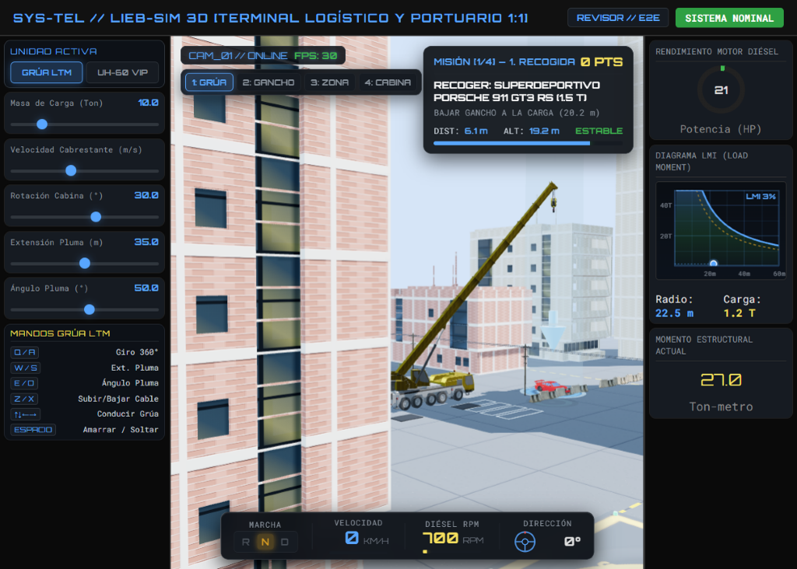
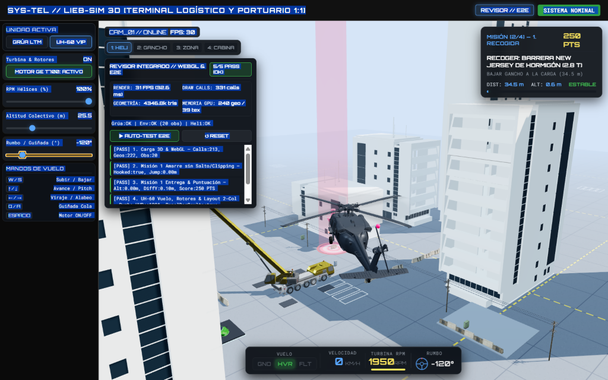
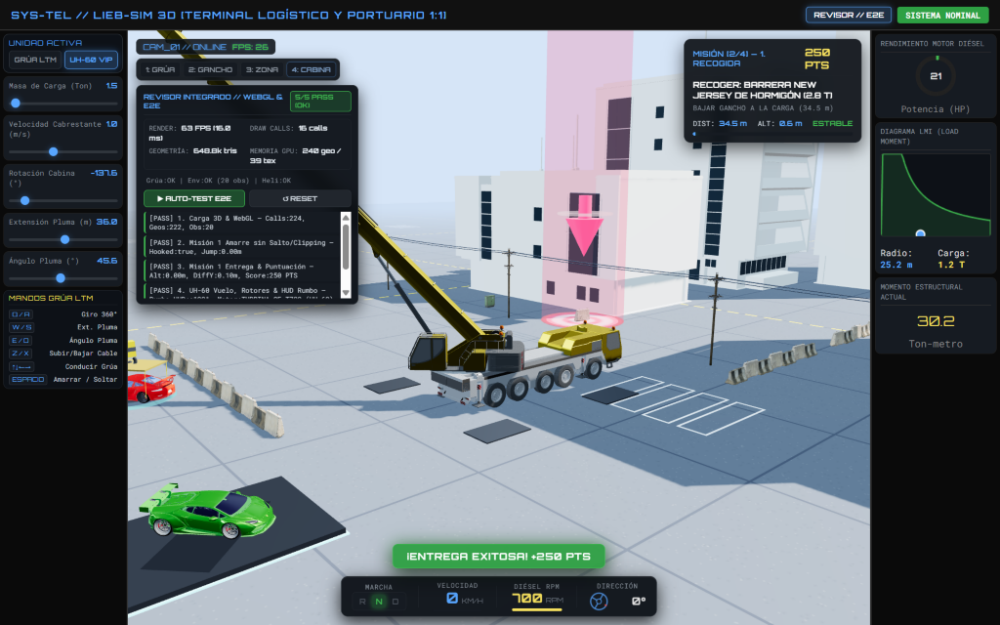

# Crane Simulator 3D — Gemelo Digital (Liebherr LTM 1110 + UH-60L Blackhawk)



Simulador interactivo en tiempo real y gemelo digital a escala métrica **1:1** de la grúa móvil **Liebherr LTM 1110** y el helicóptero táctico/VIP **UH-60L Blackhawk**, desarrollado en **HTML5**, **CSS3**, **JavaScript ES6 Modules** y renderizado 3D PBR mediante **Three.js (WebGL)**.

---

## 📸 Galería Visual y Revisor Integrado E2E

| Operación de Grúa LTM 1110 y Diagrama LMI con Cuadrícula | Modo Vuelo UH-60 VIP (Vista Expandida 2 Columnas) |
| :---: | :---: |
|  |  |

### 🔍 Revisor Integrado en Navegador (`REVISOR // E2E`)


El simulador incorpora un **Revisor y Auditor E2E Integrado en Navegador** (`src/ui/IntegratedReviewer.js`), accesible desde el botón superior **`REVISOR // E2E`**:
- **Telemetría WebGL en vivo**: Monitoriza `FPS`, tiempo de frame (`ms`), `Draw Calls`, triángulos activos y memoria GPU (`Geometrías / Texturas`).
- **Auto-Test E2E en 1 clic (`▶ AUTO-TEST E2E`)**: Ejecuta automáticamente dentro del visor 5 pruebas de regresión (carga 3D y obstáculos, amarre de carga sin salto vertical ni clipping, transporte y entrega con puntuación `+250 PTS`, vuelo/rotores/rumbo del UH-60 con layout dinámico de 2 columnas, y conmutación de las 4 cámaras).

---

## 🏗️ Características Principales

* **Doble Unidad Operativa (`GRÚA LTM` / `UH-60 VIP`):**
  * **Grúa Móvil Liebherr LTM 1110:** Conducción Ackermann con colisiones OBB, giro continuo de superestructura 360°, elevación hidráulica de pluma, extensión telescópica de 6 tramos y cabrestante con física pendular.
  * **Helicóptero UH-60L Blackhawk:** Separación dinámica de geometría para animación real del rotor principal y rotor de cola inclinado (`~10.7°`), discos de *motion blur* a altas RPM, luces aeronáuticas estroboscópicas, control de colectivo, cabeceo (*pitch*), alabeo (*roll*) y guiñada (*yaw*), expandiendo automáticamente el visor 3D a 2 columnas al ocultar la barra lateral derecha.
* **Mufla y Gancho Industrial Liebherr 110T de Alta Precisión 3D:**
  * Placas laterales biseladas (`ExtrudeGeometry`) con pintura de seguridad amarilla/negra en espiga (*chevron*) y placa **`LIEBHERR`**.
  * Conjunto interior de **3 poleas acanaladas** sobre eje cromado con tuercas hexagonales exteriores y **reenvío triple de cable de acero** que gira solidariamente con el acimut de la pluma.
  * Gancho de acero forjado de sección variable con travesaño giratorio (*trunnion*), lengüeta de seguridad articulada roja (*safety latch*) y grillete maestro para las 4 eslingas.
* **4 Misiones Pick & Place con Activos 3D Reales y Baliza Azul de Interfaz (`#58a6ff`):**
  1. **Superdeportivo Porsche 911 GT3 RS (`1.5 T`):** Izado mediante balancín separador (*spreader bar*) hasta la Bahía VIP del Parking Oeste.
  2. **Barrera New Jersey de Hormigón (`2.8 T`):** Colocación en el perímetro reservado del vial logístico.
  3. **Armario Climatizador HVAC (`4.5 T`):** Izado en altura hasta la bancada técnica sobre el forjado real de la azotea del Edificio Residencial 001 (`12.15 m`).
  4. **Armario de Subestación Eléctrica (`3.6 T`):** Instalación sobre la losa de la subestación eléctrica de obra.
* **Diagrama LMI (Load Moment Indicator) Moderno con Cuadrícula Técnica:**
  * Gráfico 2D HiDPI en tiempo real con cuadrícula cada `10 m` de radio (`0–60 m`) y `10 T` de carga (`0–50 T`), curva límite estructural del `100%` en azul interfaz (`#58a6ff`), curva punteada de preaviso al `80%`, guías de cruce (*crosshair*) e indicador **`LMI %`**.
* **Entorno Urbano Texturizado y Optimización WebGL:**
  * Manzana urbana Este/Oeste con **mapeo UV métrico por proyección cúbica** y **5 estilos arquitectónicos con relieve (`bumpMap`)** (Ladrillo Terracota, Pizarra Antracita, Arenisca Travertino, Azul Nórdico Portuario y Ocre Urbano) + acristalamiento reflectante, tendido eléctrico acoplado a aisladores, contenedores marítimos y podio VIP con Lamborghini Huracán.
  * Optimización de memoria GPU mediante compartición directa de `BufferAttribute` (sin duplicar buffers de vértices), sombras de contacto dinámicas y bucle `animate()` libre de asignaciones al *Garbage Collector*.

---

## 🕹️ Controles del Simulador

### 🎥 Selector de Cámaras
| Tecla / Botón | Modo de Cámara |
| :--- | :--- |
| `1` | **Cámara Grúa / Heli:** Órbita general alrededor de la unidad activa |
| `2` | **Cámara Gancho:** Enfoca la mufla y la carga suspendida para maniobras de precisión |
| `3` | **Cámara Zona:** Enfoca la diana y la baliza azul del objetivo activo |
| `4` | **Cámara Cabina:** Vista desde la cabina del operador (Grúa) o cámara de persecución táctica (UH-60) |

### 🏗️ Modo Grúa Liebherr LTM 1110
| Tecla / Control | Acción |
| :--- | :--- |
| `Q` / `A` | Giro continuo 360° de cabina y pluma (Izquierda / Derecha) |
| `W` / `S` | Extender / Retraer los 6 tramos telescópicos de la pluma |
| `E` / `D` | Elevar / Descender el ángulo de la pluma |
| `Z` / `X` | Subir / Bajar el cable del cabrestante |
| `↑` `↓` `←` `→` | Conducir el chasis del camión grúa (Acelerar, Frenar/Reversa, Dirección) |
| `ESPACIO` | **Amarrar Carga** (en punto de recogida) / **Depositar Carga** (sobre diana de destino) |

### 🚁 Modo Helicóptero UH-60L Blackhawk
| Tecla / Control | Acción |
| :--- | :--- |
| `W` / `S` (o `E` / `D`) | Subir / Bajar altitud de colectivo |
| `↑` / `↓` | Avance / Retroceso con inclinación física de cabeceo (*Pitch*) |
| `←` / `→` | Viraje coordinado con alabeo cíclico (*Roll*) y desplazamiento lateral |
| `Q` / `A` | Guiñada pura de rotor de cola (*Yaw*) |
| `ESPACIO` | Encender / Apagar turbina GE T700 |

---

## 🚀 Cómo Ejecutar en Local

1. **Modo Estándar (1 Clic):** Ejecuta `start.bat` para levantar el servidor local sin caché en `http://127.0.0.1:8888/index.html`.
2. **Modo Navegador Integrado (Sin abrir ventanas externas):**
   ```powershell
   python scripts/server_nocache.py 8888 --no-browser
   ```

---

## 🏛️ Estructura del Proyecto

```text
Crane_Simulator/
├── index.html                      # Interfaz principal, HUD LICCON y panel Revisor Integrado
├── start.bat                       # Lanzador local en Windows (servidor HTTP sin caché)
├── css/
│   └── style.css                   # Diseño responsive de 3/2 columnas, controles estables y HUD
├── docs/
│   └── screenshots/                # Capturas verificadas del simulador y del Auto-Test E2E
├── scripts/
│   ├── server_nocache.py           # Servidor HTTP multihilo sin caché (soporta --no-browser)
│   └── test_browser.js             # Runner CDP automatizado para línea de comandos
└── src/
    ├── main.js                     # Orquestador principal y bucle de simulación Zero-GC
    ├── config/
    │   └── constants.js            # Constantes físicas, vehiculares y límites estructurales LMI
    ├── core/
    │   ├── three.js                # Puente de exportación Three.js / OrbitControls / GLTFLoader
    │   ├── SceneManager.js         # Renderizador WebGL PBR, iluminación IBL y seguimiento de cámaras
    │   └── InputManager.js         # Gestión de teclado y atajos de cámara/acción
    ├── crane/
    │   ├── CraneModel.js           # Modelo GLTF Liebherr LTM 1110 y cinemática con dirty-checking
    │   ├── CraneController.js      # Dinámica vehicular Ackermann, colisiones OBB y motor diésel
    │   └── WinchRigging.js         # Mufla 3D de 3 poleas, gancho forjado, cables y física pendular
    ├── environment/
    │   └── Environment.js          # Entorno urbano texturizado, helipuerto, tendido eléctrico y colisiones
    ├── systems/
    │   ├── CargoManager.js         # Gestión de las 4 cargas 3D reales y aparejos de izado dinámicos
    │   ├── HelicopterController.js # Control de vuelo UH-60, animación de rotores y luces aeronáuticas
    │   └── MissionSystem.js        # Ciclo Pick & Place, puntuación y baliza visual azul 3D
    └── ui/
        ├── HUDManager.js           # Display digital de cabina y Diagrama LMI moderno con cuadrícula
        └── IntegratedReviewer.js   # Revisor WebGL en vivo y suite Auto-Test E2E integrada
```
